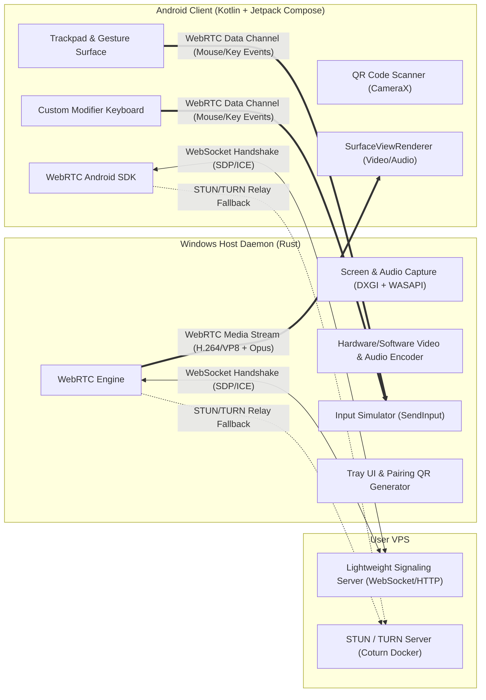

# Sway: Remote Control & Streaming Architecture Specification

## 1. Executive Summary
**Sway** is an end-to-end remote laptop control and streaming solution designed to control a Windows machine from an Android mobile device from anywhere in the world. It provides fluid, low-latency audio/video streaming coupled with a virtual trackpad, multi-touch gestures, and full keyboard input simulation.



---

## 2. Technical Stack & Component Breakdown

### 2.1 Windows Host Daemon (`host/`)
- **Language & Runtime**: Rust (safe, zero runtime overhead, compiled native executable).
- **Architecture**:
  - Elevated Windows Service: Handles unattended access, UAC prompts, and Windows Lock Screen (`Winlogon`) input injection.
  - User Tray Application: Minimalist tray icon displaying active status, connected devices, pairing QR code, keep-awake toggle, and Privacy Mode.
- **Video Capture**: DXGI Desktop Duplication API / Windows Graphics Capture API. Supports on-the-fly switching between multiple connected monitors.
- **Audio Capture**: Windows Core Audio API (WASAPI) in loopback mode to stream laptop system sound (one-way, laptop to phone).
- **Power & Session Control**: Windows `SetThreadExecutionState` to prevent unwanted laptop sleep during remote sessions, plus Wake-on-LAN (WoL) listener.
- **Input Emulation**: Win32 `SendInput` API for high-precision relative mouse delta movement, clicks, scrolling, and keyboard virtual keys/scancodes.
- **WebRTC Stack**: Pure Rust WebRTC / `libdatachannel-rs` with hardware-accelerated H.264/VP8 video encoding and Opus audio encoding.

### 2.2 Android Mobile App (`android/`)
- **Language & Framework**: Kotlin + Jetpack Compose (Material Design 3).
- **WebRTC Client**: Google WebRTC Android SDK (`org.webrtc:google-webrtc`).
- **Video Rendering**: Native hardware-accelerated `SurfaceViewRenderer` / `TextureViewRenderer`.
- **Adaptive UI & Orientation**:
  - **Portrait Mode**: Live desktop preview on top half, large dedicated multi-touch trackpad surface and modifier keys on bottom half for easy one-handed navigation.
  - **Landscape Mode**: Fullscreen immersive desktop stream with gesture overlays and toggleable controls.
- **Touch & Gesture Engine**:
  - 1-finger drag: Smooth mouse cursor movement with configurable sensitivity & acceleration sliders.
  - 1-finger tap: Left click (with subtle haptic feedback).
  - 2-finger tap: Right click (with subtle haptic feedback).
  - 2-finger vertical drag: Smooth mouse wheel scroll.
  - Long press + drag: Click-and-drag.
- **Keyboard & Modifiers**: Jetpack Compose overlay dock with sticky modifiers (`Ctrl`, `Alt`, `Shift`, `Win`, `Esc`, `Tab`, arrow keys) and system IME input.
- **Monitor Switcher**: In-app selector to cycle through laptop monitors.
- **Stream Quality Controls**: Dynamic presets ("Data Saver" 720p @ 30fps, "Balanced" 1080p @ 60fps, "Native" resolution).
- **Pairing**: CameraX with ZXing / Google Code Scanner for scanning the host QR code.

### 2.3 Signaling & Relay Server (`signaling/`)
- **Language**: Go (Golang) — ultra-lightweight (<20MB RAM, ~15MB Docker image), robust concurrency.
- **Signaling Protocol**: WebSocket-based secure room exchange:
  - Laptop registers unique device ID with an authentication challenge.
  - Phone connects with the device ID and signed pairing token.
  - Server routes SDP offers, SDP answers, and ICE candidate exchange.
  - Multi-device pairing support with device list management.
- **Relay / NAT Traversal**: Dockerized `coturn` STUN/TURN configuration included for user's VPS to guarantee connectivity behind carrier-grade NATs and mobile networks.

---

## 3. Communication Protocols & Data Formats

### 3.1 WebRTC Data Channel Protocol (Binary / Proto / MessagePack)
Mouse and keyboard events require ultra-low latency (<10ms). Input events are serialized as compact binary packets across an unordered, unreliable (or maxRetransmits=0) WebRTC Data Channel (`sway-input`):

| OpCode (1 byte) | Payload | Description |
| :--- | :--- | :--- |
| `0x01` (MouseMove) | `dx: i16, dy: i16` | Relative mouse delta (trackpad movement) |
| `0x02` (MouseDown) | `button: u8` | 1 = Left, 2 = Right, 3 = Middle |
| `0x03` (MouseUp) | `button: u8` | Button release |
| `0x04` (MouseScroll) | `delta_y: i16, delta_x: i16` | Mouse wheel step |
| `0x05` (KeyDown) | `vkey: u16, modifiers: u8` | Windows Virtual Key code & modifier bitmask |
| `0x06` (KeyUp) | `vkey: u16` | Key release |
| `0x07` (Text) | `utf8_length: u16, bytes...` | Direct Unicode text insertion via `KEYEVENTF_UNICODE` |

---

## 4. Repository Structure (Monorepo)

```
Sway/
├── android/               # Kotlin + Jetpack Compose Android Client
│   ├── app/
│   │   ├── src/main/
│   │   │   ├── java/com/sway/app/
│   │   │   │   ├── ui/        # Compose screens (Connect, StreamView, Trackpad, Controls)
│   │   │   │   ├── webrtc/    # WebRTC client & peer connection managers
│   │   │   │   ├── input/     # Gesture recognizers & key event mappers
│   │   │   │   └── pairing/   # CameraX QR scanner & key persistence
│   │   │   └── AndroidManifest.xml
│   │   └── build.gradle.kts
│   └── settings.gradle.kts
├── host/                  # Rust Windows Host Daemon
│   ├── Cargo.toml
│   └── src/
│       ├── main.rs
│       ├── capture/       # DXGI screen duplication & WASAPI audio loopback
│       ├── encoder/       # Video & Audio frame encoding
│       ├── input/         # Win32 SendInput handlers
│       ├── webrtc/        # WebRTC PeerConnection & data channel handling
│       ├── signaling/     # WebSocket client connection to VPS
│       └── tray/          # System tray icon & QR code display dialog
├── signaling/             # VPS Signaling Server & Relay
│   ├── src/               # Go or Node.js signaling daemon
│   ├── Dockerfile
│   └── docker-compose.yml # Signaling + Coturn TURN server config
└── docs/                  # Setup instructions & protocol documentation
```

---

## 5. Development Roadmap & Milestones

- **Phase 1: Signaling & P2P Skeleton**
  - Implement and test the lightweight WebSocket signaling server with Docker.
  - Establish basic WebRTC peer connection and data channel between a Rust test client and Android test client.
- **Phase 2: Input Emulation & Trackpad**
  - Implement Win32 `SendInput` processor in Rust.
  - Implement Jetpack Compose gesture surface and send delta mouse events over the WebRTC data channel.
  - Verify trackpad responsiveness and modifier keyboard in real time.
- **Phase 3: Screen & Audio Capture Pipeline**
  - Implement DXGI desktop capture and WASAPI audio capture in Rust.
  - Pipe encoded video and audio into WebRTC media tracks.
  - Render stream in Android using `SurfaceViewRenderer`.
- **Phase 4: Pairing UI & Production Hardening**
  - Rust system tray menu and QR code generation.
  - Android CameraX QR scanner and persistent device token store.
  - Coturn TURN server integration on VPS for reliable off-network access.
